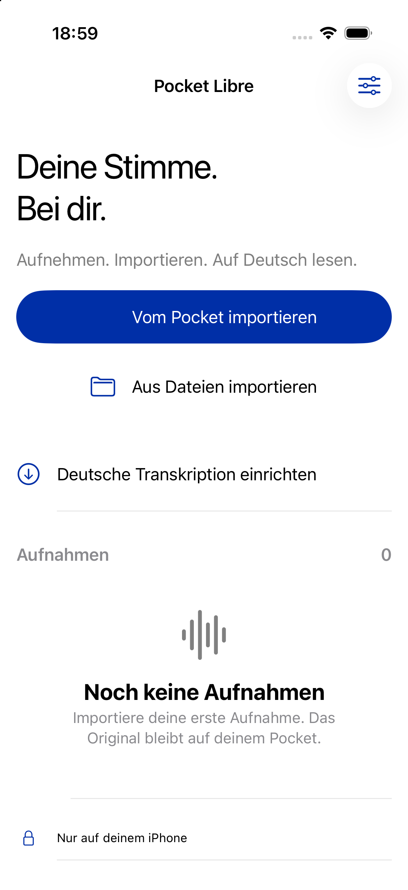
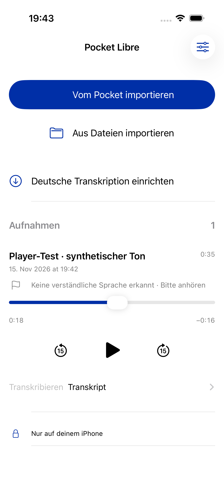

# Pocket Libre

Pocket-Aufnahmen lokal importieren, auf Deutsch transkribieren und anhören.
Dieser Fork ergänzt [Pocket Libre](https://github.com/shahcolate/pocket-libre)
um eine native iPhone-App. Nach dem einmaligen Modell-Download braucht sie weder
Cloud noch einen laufenden Mac.

## iPhone-App

- Import per Bluetooth oder aus Dateien; lokaler WLAN-Import ist implementiert.
- Deutsche Transkription mit WhisperKit, automatisch oder über eine Warteschlange.
- Player mit Play/Pause, Zeitleiste und 15-Sekunden-Sprüngen.
- Bearbeitbare Titel, Text-Export und Hinweise bei unsicherer Erkennung.
- Bestehende Pocket-Kopplung übernehmen, ohne Reset.

<table>
<tr><td></td><td></td></tr>
<tr><td>Bibliothek · Version 0.2.1</td><td>Player · Version 0.3.0</td></tr>
</table>

Simulator-Screenshots mit leerer Bibliothek bzw. synthetischer Testaufnahme.
Die aktuelle Version 0.3.2 ergänzt Titelbearbeitung und eine animierte Gerätekarte.
Keine privaten Aufnahmen oder Transkripte sind abgebildet.

## Starten

1. `ios/PocketLibre.xcodeproj` in Xcode öffnen, eigenes Signing-Team wählen und auf dem iPhone starten.
2. Das deutsche Sprachmodell in der App einmalig laden.
3. Für Bluetooth den [bestehenden Sitzungsschlüssel übernehmen](ios/SESSION_KEY.md),
   Pocket verbinden und Aufnahmen auswählen. Alternativ aus Dateien importieren.

[iPhone-Einrichtung und Tests](ios/README.md) · [Python-CLI-Referenz](README-CLI.md) · [Geräteprotokoll](PROTOCOL.md)

## Getesteter Stand

Bluetooth-Import und Schlüsselübernahme wurden auf einem iPhone 15 Pro Max bestätigt.
WLAN-Import, direkte iPhone-USB-Kompatibilität und die neue automatische Wiederverbindung
sind noch nicht auf echter Hardware bestätigt. Die Transkriptionsqualität hängt von
der Aufnahme ab; insbesondere dumpfe Aufnahmen können fehlerhafte Ergebnisse liefern.

## Datenschutz

Die iPhone-App verarbeitet Audio lokal, ohne Cloud-Fallback. Nur der ausdrücklich
bestätigte Modell-Download verwendet das Internet. Aufnahmen und Transkripte liegen
mit iOS-Dateischutz lokal und sind von Geräte-Backups ausgeschlossen. Beim Löschen
der App gehen diese Kopien verloren; Originale auf dem Pocket werden nicht gelöscht.

Ein separater verschlüsselter Journal-Vault, KI-Zusammenfassungen und RAG-Chat sind
noch nicht implementiert. Die Python-CLI besitzt optionale Cloud-Analysefunktionen;
diese Aussage zum Offline-Verhalten bezieht sich auf die iPhone-App.

## Lizenz

[MIT](LICENSE) bleibt für den bisherigen Unterbau und bereits veröffentlichte Fassungen erhalten.
Für neue eigene App-Erweiterungen liegt eine [separate Lizenzvorbereitung](licensing/README.md)
vor: nichtkommerzielle Nutzung, kommerzielle Nutzung nur nach schriftlicher Genehmigung.
**Der Entwurf ist noch nicht in Kraft.** Gerätekommunikation basiert auf Pocket Libre. Kein Code aus
`osbock/pocket-sync` wurde übernommen. Abhängigkeiten: [iPhone-Dokumentation](ios/README.md).
